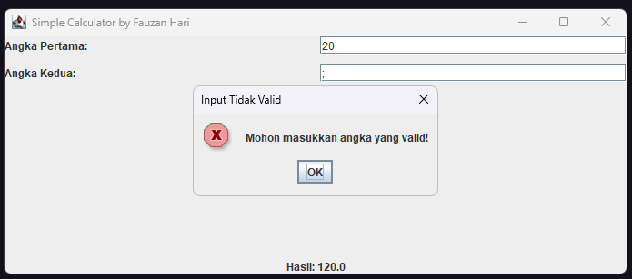
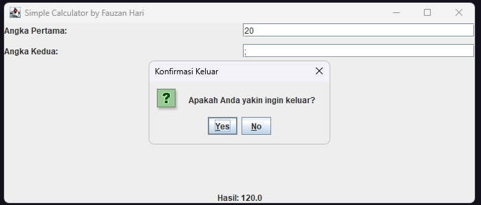

## NAMA : FAUZAN HARI RAMDANI

## NIM : FF1D02410047

# Simple Calculator

Aplikasi kalkulator sederhana berbasis **Java Swing** untuk latihan
dasar Graphical User Interface (GUI) dan event handling pada mata kuliah
Pemrograman Berorientasi Objek (PBO).

Aplikasi menerima dua angka, menyediakan empat operasi aritmetika dasar,
menampilkan hasil pada jendela, serta memberikan dialog peringatan
ketika input tidak valid atau terjadi pembagian dengan nol.

## 1. Fitur Aplikasi

- Memasukkan angka pertama dan angka kedua.
- Penjumlahan (`+`).
- Pengurangan (`-`).
- Perkalian (`*`).
- Pembagian (`/`).
- Menampilkan hasil perhitungan pada label.
- Menampilkan pop-up jika input bukan angka atau kosong.
- Menampilkan peringatan jika pengguna mencoba membagi dengan nol.
- Meminta konfirmasi sebelum aplikasi ditutup.

## 2. Teknologi dan Komponen

- **Bahasa:** Java
- **GUI:** Java Swing
- **Event handling:** `ActionListener` dan `WindowAdapter`

Komponen GUI yang digunakan:

Komponen Kegunaan

---

`JFrame` Jendela utama aplikasi
`JPanel` Mengelompokkan komponen GUI
`JLabel` Menampilkan label input dan hasil
`JTextField` Menerima input angka
`JButton` Menjalankan operasi aritmetika
`JOptionPane` Menampilkan dialog peringatan dan konfirmasi

## 3. Struktur Project

```text
SimpleCalculator/
└── src/
    ├── Main.java
    └── CalculatorFrame.java
```

Project menggunakan dua class utama:

### `Main.java`

Class ini merupakan titik awal program. Method `main()` membuat objek
`CalculatorFrame`, kemudian menampilkan jendela kalkulator melalui
`setVisible(true)`.

### `CalculatorFrame.java`

Class ini mengatur seluruh tampilan dan perilaku kalkulator. Class
mewarisi `JFrame` dan mengimplementasikan `ActionListener`. Di dalamnya
terdapat deklarasi komponen, pengaturan layout, pendaftaran event
listener, logika operasi matematika, dan penanganan input yang tidak
valid.

## 4. Penerapan Materi GUI

### A. Top-level Container Class

`CalculatorFrame` menggunakan `JFrame` sebagai jendela utama aplikasi:

```java
public class CalculatorFrame extends JFrame implements ActionListener
```

Pengaturan jendela dilakukan melalui `setTitle()`, `setSize()`,
`setDefaultCloseOperation()`, dan `setLocationRelativeTo()`.

### B. Intermediate Container Class

Aplikasi menggunakan tiga objek `JPanel` untuk mengelompokkan komponen:

- `mainPanel`: panel utama yang menampung seluruh bagian kalkulator.
- `inputPanel`: panel untuk label dan kolom input angka.
- `buttonPanel`: panel untuk tombol operasi.

### C. Atomic Component Class

Komponen atomik yang digunakan antara lain:

- `JLabel` untuk teks "Angka Pertama", "Angka Kedua", dan hasil.
- `JTextField` untuk menerima dua angka dari pengguna.
- `JButton` untuk tombol tambah, kurang, kali, dan bagi.

### D. Layout Classes

Aplikasi menggunakan tiga layout manager:

---

Layout Penerapan Fungsi

---

`BorderLayout` `mainPanel` Menempatkan panel input
di bagian `NORTH`,
tombol di `CENTER`, dan
hasil di `SOUTH`.

`GridLayout` `inputPanel` Menyusun dua baris dan
dua kolom untuk label
serta kolom input.

`FlowLayout` `buttonPanel` Menyusun tombol operasi
secara horizontal di
tengah dan tidak
memaksa tombol memenuhi
seluruh ruang panel.

---

Dengan demikian, aplikasi telah menggunakan lebih dari dua layout
manager sesuai instruksi latihan.

### E. Event Listener dan Method Override

Class `CalculatorFrame` mengimplementasikan interface `ActionListener`.
Keempat tombol didaftarkan menggunakan `addActionListener(this)`.

Method `actionPerformed(ActionEvent e)` dioverride untuk merespons klik
tombol. Program memeriksa tombol yang menjadi sumber event menggunakan
`e.getSource()`, kemudian menjalankan operasi yang sesuai.

Aplikasi juga menggunakan `WindowAdapter` dan mengoverride
`windowClosing(WindowEvent e)` untuk menampilkan dialog konfirmasi
sebelum jendela ditutup.

## 5. Penanganan Input dan Pop-up

- **Input tidak valid:** `NumberFormatException` ditangani dengan
  `try-catch`. Jika teks kosong atau bukan angka, aplikasi menampilkan
  dialog error menggunakan `JOptionPane`.
- **Pembagian dengan nol:** sebelum pembagian dilakukan, program
  memeriksa apakah angka kedua sama dengan nol. Jika iya, aplikasi
  menampilkan dialog peringatan dan menghentikan proses operasi.
- **Konfirmasi keluar:** ketika pengguna menekan tombol tutup jendela,
  `showConfirmDialog()` menampilkan pilihan Yes/No. Aplikasi ditutup
  hanya jika pengguna memilih Yes.

## 6. Dokumentasi Screenshot

### Tampilan kalkulator dan hasil perhitungan

Contoh berikut menunjukkan input `20` dan `6`, kemudian hasil perkalian
`120.0` ditampilkan pada bagian bawah jendela.


### Peringatan pembagian dengan nol

Ketika angka kedua bernilai `0` dan pengguna memilih operasi pembagian,
aplikasi menampilkan dialog peringatan.


### Peringatan input tidak valid

Jika pengguna memasukkan karakter yang bukan angka, aplikasi menampilkan
pesan bahwa input harus berupa angka yang valid.



### Konfirmasi keluar aplikasi

Ketika tombol close pada jendela ditekan, aplikasi meminta konfirmasi.
Pilihan **Yes** menutup aplikasi, sedangkan **No** membatalkan proses
keluar.



## 7. Cara Menjalankan Aplikasi

1.  Pastikan Java Development Kit (JDK) sudah terpasang.
2.  Buka project `SimpleCalculator` melalui IDE, misalnya NetBeans,
    IntelliJ IDEA, atau Eclipse.
3.  Pastikan `Main.java` dan `CalculatorFrame.java` berada dalam package
    yang sama.
4.  Jalankan file `Main.java`.
5.  Masukkan dua angka, lalu klik tombol operasi yang diinginkan.

Jika menggunakan terminal, masuk ke direktori tempat kedua file Java
berada, kemudian jalankan:

```bash
javac Main.java CalculatorFrame.java
java Main
```

## 8. Contoh Pengujian

    Angka pertama   Angka kedua Operasi   Hasil yang diharapkan

---

               20             6 `+`       `26.0`
               20             6 `-`       `14.0`
               20             6 `*`       `120.0`
               20             6 `/`       `3.3333333333333335`
               20             0 `/`       Dialog peringatan pembagian dengan nol
            `abc`             6 `+`       Dialog input tidak valid
           kosong             6 `+`       Dialog input tidak valid

## 9. Kesimpulan

Simple Calculator merupakan latihan GUI dasar menggunakan Java Swing.
Aplikasi ini menerapkan `JFrame` sebagai top-level container, `JPanel`
sebagai intermediate container, beberapa atomic component, tiga layout
manager (`BorderLayout`, `GridLayout`, dan `FlowLayout`), serta event
handling melalui `ActionListener` dan `WindowAdapter`.

Melalui aplikasi ini, pengguna dapat mempelajari bagaimana komponen GUI
disusun dalam sebuah jendela dan bagaimana program merespons interaksi
pengguna melalui event listener.
